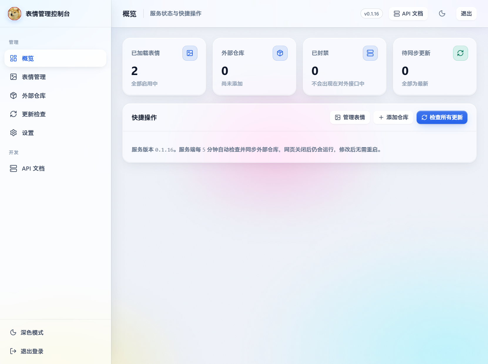
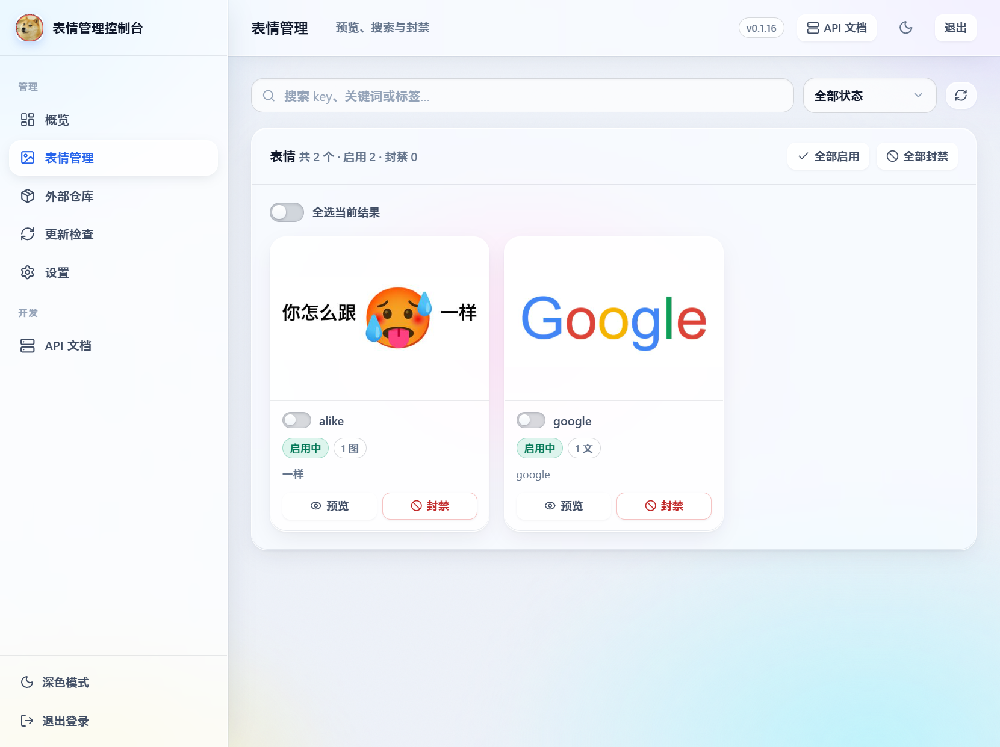
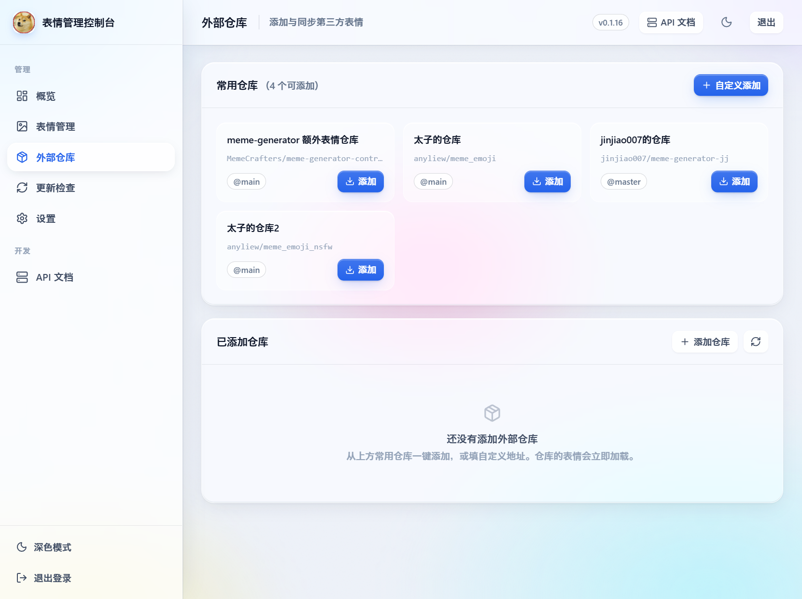
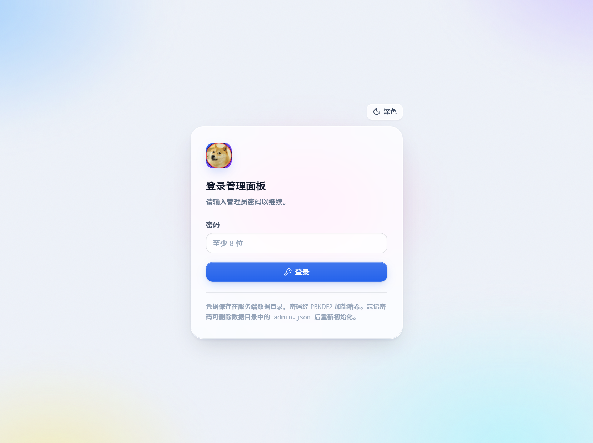
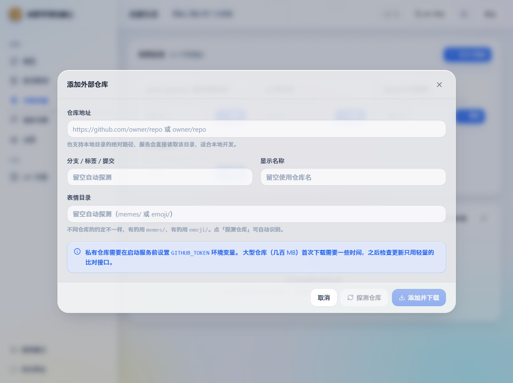
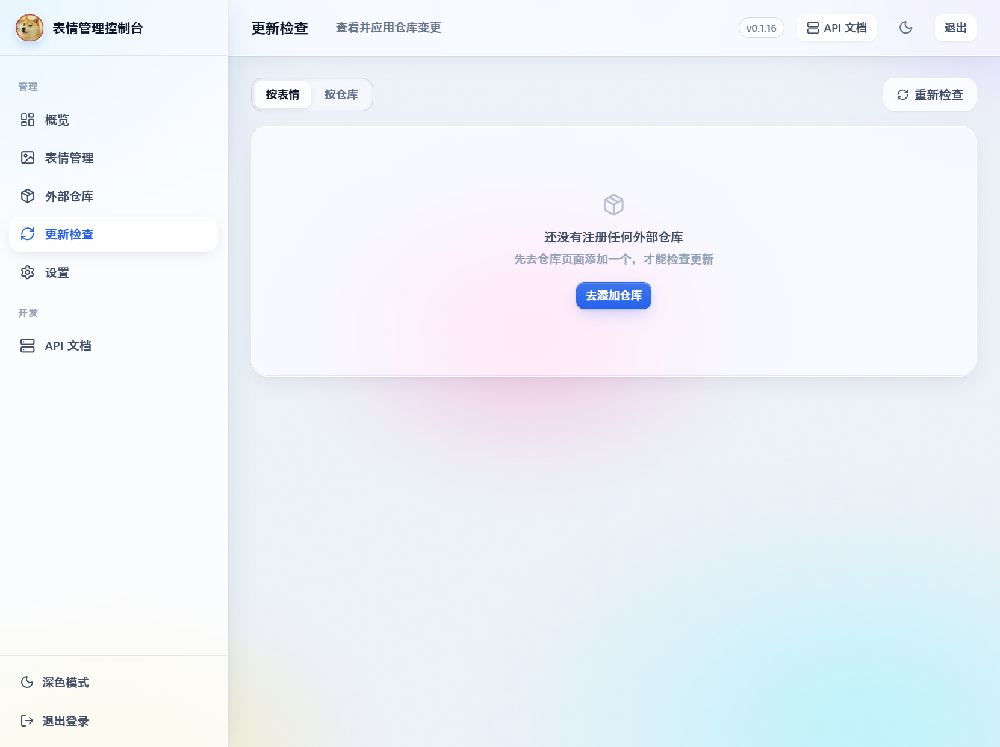
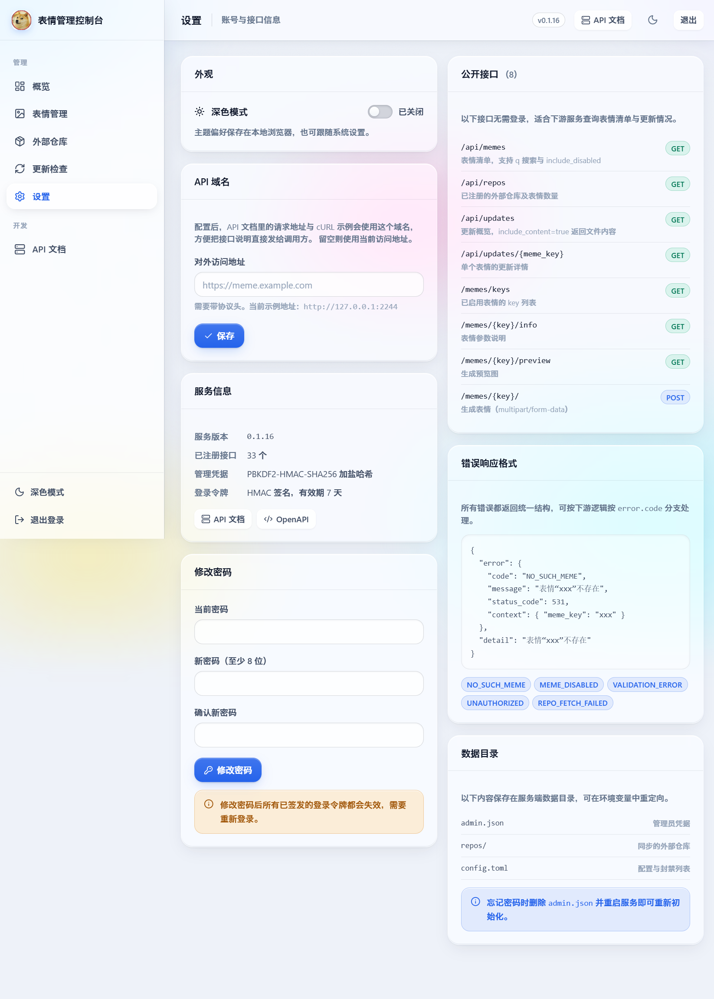
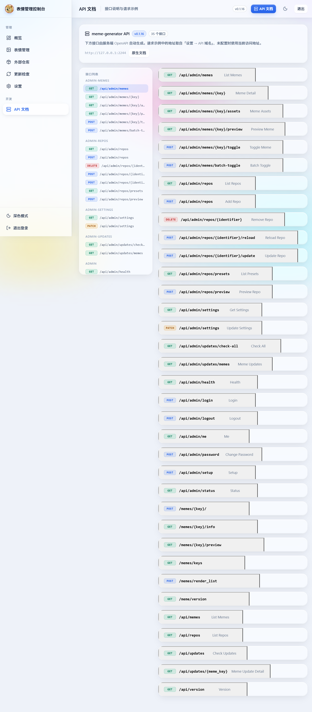

# meme-generator

一个基于 Python、FastAPI、Pillow/skia 的表情包生成服务，**自带 Web 管理面板**与**外部表情仓库管理**。

仓库本身只保留两个示例表情（`google`、`alike`）作为模板，实际使用的表情通过外部仓库在管理面板里一键添加。
这样仓库保持轻量，同时还能用上社区维护的完整表情集合（官方 contrib 仓库 13 个、太子的仓库 429 个等）。

## 功能

- **表情生成 API**：文本 / 图片模板，支持 GIF，自动生成 OpenAPI 文档。
- **Web 管理面板**：首次进入设置管理员密码；支持表情预览、搜索、封禁、仓库管理与更新检查。
- **外部表情仓库**：一键添加社区仓库，自动识别表情目录，支持更新检测、增量更新与卸载。
- **GitHub 加速源**：给仓库设置镜像前缀（如 `https://ghfast.top/`，也可以填自建镜像），加速源不可用时自动退回直连。
- **常用仓库预设**：内置常用仓库列表，点击即装，不用记地址。
- **更新查询 API**：可查询哪些表情有更新、更新了哪些文件，并直接拿到新代码，方便下游同步。
- **统一错误响应**：所有错误都带机器可读的 `error.code`。
- **内置主题**：管理面板支持浅色 / 深色主题，移动端使用底部导航。

## 快速开始

### Docker 快速体验（推荐）

已发布的镜像支持 `linux/amd64` 和 `linux/arm64`，安装 Docker 后即可启动，无需克隆仓库或本地构建：

```bash
docker run -d --name meme-generator -p 2233:2233 \
  -v meme-data:/data \
  virtualangel0721/meme-generator:latest
```

打开 [http://127.0.0.1:2233](http://127.0.0.1:2233) 进入管理面板，首次访问设置管理员密码，
然后在「外部仓库」页面添加表情仓库即可使用。服务端每 5 分钟自动检查并同步仓库，关闭网页后仍会运行。

`meme-data` 卷保存管理员凭据和同步的外部仓库，重建容器时继续挂载同一个卷即可保留这些数据。
容器每次启动会根据环境变量重新生成 `/data/config.toml`；直接修改该文件或在面板里修改的封禁列表会在下次启动时被覆盖。
镜像地址：[Docker Hub](https://hub.docker.com/r/virtualangel0721/meme-generator)；也可使用
`ghcr.io/all-thoughts-are-broken/meme-generator:latest`。需要固定版本时可将 `latest` 改为 `0.1.16`。

### 从源码启动

```bash
uv sync --locked
uv run meme run
```

打开 `http://127.0.0.1:2233` 即是管理面板，**首次进入会要求设置管理员密码**；API 文档在 `/docs`。

内置示例表情：

| key | 类型 | 输入 | 说明 |
| --- | --- | --- | --- |
| `google` | 文本模板 | 1 段文本 | 把文字渲染成 Google 彩色风格 |
| `alike` | 图片模板 | 1 张图片 | “你怎么跟……一样”模板 |

```bash
uv run meme generate google --texts "Hello"      # 文本表情
uv run meme generate alike --images avatar.jpg   # 图片表情
uv run meme list                                 # 查看已加载表情
```

## 管理面板

打开首页即可使用，首次访问设置管理员密码（至少 8 位）。密码用 PBKDF2-HMAC-SHA256
加盐哈希后保存在服务端数据目录；登录令牌是无状态 HMAC 签名，重启服务不会踢掉已登录会话。

| 页面 | 功能 |
| --- | --- |
| 概览 | 表情 / 仓库 / 封禁数量统计，一键检查全部更新 |
| 表情管理 | 网格预览、按 key/关键词/标签搜索、按状态与来源筛选、单个或批量封禁 |
| 外部仓库 | 常用仓库一键添加、自定义地址、设置加速源、更新、重新加载、移除 |
| 更新检查 | 按表情或按仓库查看变更，对比变更文件的新旧代码，一键应用 |
| 设置 | 切换主题、修改密码、配置 GitHub 加速源、查看公开接口与错误码 |

**封禁**与删除不同：被封禁的表情仍然注册在服务里，只是不再出现在对外接口中，随时可以恢复。

数据目录位置：

| 平台 | 路径 |
| --- | --- |
| Windows | `%LOCALAPPDATA%\meme_generator` |
| Linux | `~/.local/share/meme_generator` |
| macOS | `~/Library/Application Support/meme_generator` |

数据目录里的 `admin.json` 保存管理员凭据，`repos/` 保存同步下来的外部仓库。
Linux 设置了 `XDG_DATA_HOME` 时，默认数据目录为 `$XDG_DATA_HOME/meme_generator`；
设置 `MEME_GENERATOR_DATA_DIR` 后，以该环境变量指定的路径为准。Docker 镜像默认使用 `/data`。
配置与封禁列表保存在配置目录的 `config.toml` 中，具体位置见下方「配置」。
忘记密码的重置步骤见下方「常见问题（Q&A）」。

### 浅色模式截图

以下截图展示仅加载内置示例表情、尚未添加外部仓库时的实际界面。

**概览**：查看表情、仓库、封禁与待同步更新数量，并通过快捷入口进入管理页面。



**表情管理**：预览表情，按关键词、状态与来源筛选，支持单个或批量封禁。



**外部仓库**：浏览常用仓库预设，添加与管理第三方表情仓库。



<details>
<summary>展开查看更多界面：登录、添加仓库、更新检查、设置与 API 文档</summary>

**登录**：输入管理员密码进入管理面板。



**添加外部仓库**：填写仓库地址、分支与表情目录，探测后添加并下载。



**更新检查**：按表情或仓库查看变更；截图展示尚未添加仓库时的提示。



**设置**：切换主题、设置 API 域名、修改密码，查看服务信息与错误响应格式。



**API 文档**：查看接口说明、参数与请求示例。



</details>

## 外部表情仓库

### 在面板里添加（推荐）

打开「外部仓库」页面，可以直接从常用仓库里一键添加：

| 仓库 | 说明 |
| --- | --- |
| `MemeCrafters/meme-generator-contrib` | 官方额外表情仓库（13 个） |
| `anyliew/meme_emoji` | 太子的仓库（429 个，表情目录为 `emoji/`） |
| `jinjiao007/meme-generator-jj` | jinjiao007 的仓库（84 个，分支 `master`） |
| `anyliew/meme_emoji_nsfw` | 太子的仓库 2（36 个） |

也可以填任意 GitHub 地址（`owner/repo` 或完整 URL）或本地绝对路径。添加前可以点
**探测仓库**，服务会先识别分支和表情目录、统计表情数量，确认无误再下载。

不同仓库的表情目录约定不一样，服务会自动识别 `memes/`、`emoji/` 或直接放在根目录的情况，
也可以在添加时手动指定。

> 私有仓库或遇到 GitHub 接口限流时，在启动服务前设置 `GITHUB_TOKEN` 环境变量。

### 加速源（GitHub 镜像）

国内访问 GitHub 不稳定时，可以给仓库设置一个**加速源**。加速源就是一个纯粹的地址前缀，
拼在真实地址前面：

| | 地址 |
| --- | --- |
| 原始仓库 | `https://github.com/MemeCrafters/meme-generator-contrib` |
| 加速源 | `https://ghfast.top/` |
| 实际请求 | `https://ghfast.top/https://github.com/MemeCrafters/meme-generator-contrib` |

三种设置方式：

1. **外部仓库页顶部横幅**：一眼看到当前全局加速源，点「设置加速源」直接改。
2. **单个仓库**：在「外部仓库」页面点某个仓库的**加速源**按钮单独设置，覆盖全局默认。
3. **设置页 / 配置文件**：「设置」→「GitHub 加速源」填一次全局生效；等价于 `config.toml`
   的 `[repo] github_proxy`，或启动前设置 `GITHUB_PROXY` 环境变量。

加速源填什么都行（内置预设只是几个常见的公共镜像，也可以填自建的那一个），
只保存在服务端配置里，不会进代码仓库。添加仓库时也能在「加速源」里选或直接填；
如果把手头加速好的整串地址（`https://ghfast.top/https://github.com/owner/repo`）
粘进仓库地址，服务会自动拆成两栏。拿不准哪个加速源快，点**测试加速源**会分别访问
GitHub 接口、raw 内容与归档，并和直连比耗时。

加速源是「加速源优先、直连兜底」：加速源连不上、返回错误页或者返回的不是合法归档时，
服务会自动退回直连，不会因为加速源挂掉而同步失败，也不需要清空加速源配置。
换加速源不会导致表情重复下载——文件哈希来自 GitHub 自身，与访问途径无关。

不同加速源支持的端点并不一样：有的只代理 `raw.githubusercontent.com`，不代理归档
（`codeload.github.com`）或接口（`api.github.com`）。服务按主机分别判断可用性，
某一类请求不可用只会让它走直连，其余照常走加速源；「测试加速源」会逐条列出结果，
日志里也会记录每个主机最终走的是加速源还是直连。

### 更新机制

检查更新走 GitHub 的文件树接口，只比对文件哈希，不下载内容——即使 429 个表情、541MB 的仓库，
检查也只需一次请求。服务启动后等待 5 分钟开始自动检查，有变化时只下载发生变化的文件并自动应用；
以服务启动时刻为基准每 5 分钟检查一次；同步超时会跳过错过的时点，避免重叠或补跑。
此任务在服务端运行，无需登录或保持网页打开。
单个仓库检查或同步失败不会影响其他仓库，下一轮会继续重试；也可以在管理面板手动触发更新。

新增或修改的表情在应用更新后会立即加载，**无需重启服务**；被封禁的表情保持封禁状态。

### 放到本地目录

在配置里声明目录，或直接在面板里填本地绝对路径：

```toml
[meme]
meme_dirs = ["/data/memes"]
```

### 放进本仓库

在 `meme_generator/memes/<key>/__init__.py` 里定义并注册：

```python
from datetime import datetime

from pil_utils import BuildImage

from meme_generator import MemeArgsModel, add_meme


def hello(images: list[BuildImage], texts: list[str], args: MemeArgsModel):
    frame = BuildImage.new("RGB", (500, 200), "white")
    frame.draw_text((20, 20, 480, 180), texts[0], max_fontsize=64, halign="center")
    return frame.save_jpg()


add_meme(
    "hello",
    hello,
    min_texts=1,
    max_texts=1,
    default_texts=["Hello"],
    keywords=["hello"],
    date_created=datetime(2026, 1, 1),
)
```

表情带静态图片资源时，放在该表情目录下并刷新资源清单：

```bash
uv run python tools/update_resource_list.py
```

## API

### 生成与查询（公开）

| 方法 | 路径 | 说明 |
| --- | --- | --- |
| `GET` | `/memes/keys` | 已启用表情的 key 列表 |
| `GET` | `/memes/{key}/info` | 表情参数约束、关键词、标签 |
| `GET` | `/memes/{key}/preview` | 生成预览图（图片二进制） |
| `POST` | `/memes/{key}/` | 生成表情，`multipart/form-data` |
| `POST` | `/memes/render_list` | 渲染表情列表图片 |
| `GET` | `/meme/version` | 服务版本 |

```bash
curl -X POST http://127.0.0.1:2233/memes/google/ \
  -F "texts=Hello API" \
  --output google.jpg
```

### 清单与更新查询（公开）

适合下游服务同步表情：

| 方法 | 路径 | 说明 |
| --- | --- | --- |
| `GET` | `/api/version` | 版本信息 |
| `GET` | `/api/memes` | 表情清单，支持 `q` 搜索与 `include_disabled` |
| `GET` | `/api/repos` | 已注册的外部仓库及其表情 |
| `GET` | `/api/updates` | 更新概览，`include_content=true` 时返回变更文件内容 |
| `GET` | `/api/updates/{meme_key}` | 单个表情的更新详情 |

**查询某个表情是否有更新、更新了哪些文件：**

```bash
curl "http://127.0.0.1:2233/api/updates?include_content=true"
```

响应中每个表情都会列出状态（`new` / `updated` / `removed`）、涉及的文件路径，以及代码文件的
新内容（`content`）与被覆盖前的内容（`previous_content`）。下游据此可以只拉取变化的表情，
而不必同步整个仓库。

### 管理接口（需登录）

挂在 `/api/admin/*` 下，需要 `Authorization: Bearer <token>`。令牌也可作为 `token` 查询参数
传递（预览图片在 `` 中直接引用时用得上）。

<details>
<summary>展开查看接口列表</summary>

**认证**

| 方法 | 路径 | 说明 |
| --- | --- | --- |
| `GET` | `/api/admin/status` | 是否已初始化、当前是否已登录 |
| `POST` | `/api/admin/setup` | 首次设置管理员密码 |
| `POST` | `/api/admin/login` | 登录并获取令牌 |
| `POST` | `/api/admin/logout` | 登出（前端丢弃令牌即可） |
| `POST` | `/api/admin/password` | 修改密码，旧令牌全部失效 |
| `GET` | `/api/admin/health` | 服务概览数据 |

**表情管理**

| 方法 | 路径 | 说明 |
| --- | --- | --- |
| `GET` | `/api/admin/memes` | 列表，支持 `q`、`status`、`source` 过滤 |
| `GET` | `/api/admin/memes/{key}` | 详情，含快捷指令 |
| `GET` | `/api/admin/memes/{key}/assets` | 表情目录下的文件清单 |
| `GET` | `/api/admin/memes/{key}/preview` | 预览图，禁用状态也可预览 |
| `POST` | `/api/admin/memes/{key}/toggle` | 封禁 / 启用单个表情 |
| `POST` | `/api/admin/memes/batch-toggle` | 批量封禁 / 启用 |

**仓库与更新**

| 方法 | 路径 | 说明 |
| --- | --- | --- |
| `GET` | `/api/admin/repos` | 已注册仓库 |
| `GET` | `/api/admin/repos/presets` | 常用仓库列表及安装状态 |
| `GET` | `/api/admin/repos/proxies` | 可选的加速源（全局默认 + 预设） |
| `POST` | `/api/admin/repos/proxy-test` | 测试加速源可用性与耗时 |
| `POST` | `/api/admin/repos/preview` | 探测仓库：识别分支与表情目录 |
| `POST` | `/api/admin/repos` | 添加仓库并下载，`proxy` 指定加速源 |
| `PATCH` | `/api/admin/repos/{identifier}` | 修改加速源或显示名，可顺带重新拉取 |
| `DELETE` | `/api/admin/repos/{identifier}` | 移除仓库并卸载其表情 |
| `POST` | `/api/admin/repos/{identifier}/update` | 更新，`apply=false` 时只检查 |
| `POST` | `/api/admin/repos/{identifier}/reload` | 从本地内容重新加载表情 |
| `GET` | `/api/admin/updates/check` | 检查单个仓库的更新 |
| `GET` | `/api/admin/updates/check-all` | 检查全部仓库 |
| `GET` | `/api/admin/updates/memes` | 按表情汇总的待同步列表 |

</details>

### 错误响应

所有错误都返回统一结构：

```json
{
  "error": {
    "code": "NO_SUCH_MEME",
    "message": "表情“xxx”不存在",
    "status_code": 531,
    "context": { "meme_key": "xxx" }
  },
  "detail": "表情“xxx”不存在"
}
```

`detail` 字段与历史版本一致，已有调用方无需改动。常见 `code`：

| code | 说明 |
| --- | --- |
| `NO_SUCH_MEME` | 表情不存在 |
| `MEME_DISABLED` | 表情已被管理员封禁 |
| `IMAGE_NUMBER_MISMATCH` / `TEXT_NUMBER_MISMATCH` | 图片 / 文本数量不符 |
| `OPEN_IMAGE_FAILED` | 图片无法解析 |
| `TEXT_OVER_LENGTH` | 文本过长 |
| `ARG_MODEL_MISMATCH` | 额外参数校验失败 |
| `VALIDATION_ERROR` | 请求格式错误（HTTP 422） |
| `UNAUTHORIZED` / `TOKEN_INVALID` | 未登录 / 令牌无效 |
| `REPO_NOT_FOUND` / `REPO_ALREADY_EXISTS` / `REPO_INVALID` / `REPO_FETCH_FAILED` | 仓库相关错误 |

## 配置

`config.toml` 默认位于以下配置目录，与管理员凭据所在的数据目录分别管理：

| 平台 | 默认配置文件 |
| --- | --- |
| Windows | `%APPDATA%\meme_generator\config.toml` |
| Linux | `~/.config/meme_generator/config.toml` |
| macOS | `~/Library/Application Support/meme_generator/config.toml` |
| Docker 镜像 | `/data/config.toml` |

Linux 设置了 `XDG_CONFIG_HOME` 时，默认配置文件为 `$XDG_CONFIG_HOME/meme_generator/config.toml`。
可用以下环境变量覆盖默认位置：

| 环境变量 | 说明 |
| --- | --- |
| `MEME_GENERATOR_CONFIG_FILE` | 指定配置文件路径 |
| `MEME_GENERATOR_DATA_DIR` | 数据目录（管理员凭据、外部仓库） |
| `MEME_GENERATOR_CONFIG_DIR` | 配置目录 |
| `MEME_GENERATOR_CACHE_DIR` | 缓存目录 |
| `GITHUB_TOKEN` / `GH_TOKEN` | 访问私有仓库或提高 GitHub 接口配额 |
| `GITHUB_PROXY` | GitHub 加速源前缀（如 `https://ghfast.top/`），等价于 `[repo] github_proxy` |

```toml
[meme]
load_builtin_memes = true
meme_dirs = []
# 被封禁的表情；管理面板会自动维护这个列表
meme_disabled_list = []

[resource]
resource_url = ""
resource_urls = []

[repo]
# GitHub 加速源前缀，形如 https://ghfast.top/ ；留空直连 GitHub。
# 这里填自己的镜像也可以，只写进本机配置，不会进代码仓库。
# 单个仓库可以在管理面板里单独覆盖这个默认值。
github_proxy = ""
# 管理面板里可点选的加速源
proxy_presets = ["https://ghfast.top/", "https://gh-proxy.com/", "https://ghproxy.net/"]

[gif]
gif_max_size = 10
gif_max_frames = 100

[translate]
baidu_trans_appid = ""
baidu_trans_apikey = ""

[server]
host = "127.0.0.1"
port = 2233

[log]
log_level = "INFO"
```

## Docker

直接体验可使用上方「Docker 快速体验」的已发布镜像。
以下方式适合克隆本仓库后从源码构建。

用 Compose 构建并启动：

```bash
docker compose up -d
```

或者直接用 Docker：

```bash
docker build -t meme-generator .
docker run -d --name meme-generator -p 2233:2233 -v meme-data:/data meme-generator
```

容器内监听 `0.0.0.0:2233`。管理员凭据和同步的外部仓库保存在 `/data` 卷，
重建容器时继续挂载同一个卷即可保留这些数据。
`/data/config.toml` 在每次启动时由环境变量和模板重新生成，直接修改的配置与面板维护的封禁列表会被覆盖。

`docker-compose.yml` 里已配置健康检查，并预留了 `GITHUB_TOKEN`、`GITHUB_PROXY`、百度翻译等可选环境变量。

### 自动构建与推送（GitHub Actions）

`.github/workflows/docker.yml` 负责自动构建镜像；构建脚本 `npm run build` 与
依赖安装都在镜像内完成，所以推送的镜像自带最新的管理面板。

| 触发 | 行为 |
| --- | --- |
| Pull Request、非 `main` 分支推送 | 只构建 `linux/amd64` 并跑冒烟测试，不推送 |
| 推送到 `main` | 构建 `linux/amd64` + `linux/arm64` 并推送 `latest`、`sha-<短提交>` |
| 推送 `v*` tag | 额外推送 `1.2.3`、`1.2` 这类版本号标签 |
| Actions → Docker → Run workflow | 手动触发，可选择是否推送 |

镜像地址：

- GHCR（始终推送，无需任何配置）：`ghcr.io/<owner>/meme-generator`
- Docker Hub（可选）：`<DOCKERHUB_USERNAME>/meme-generator`

要用 Docker Hub，在仓库 `Settings → Secrets and variables → Actions` 里添加
`DOCKERHUB_USERNAME` 与 `DOCKERHUB_TOKEN`（Docker Hub 后台创建的 Access Token，不要用登录密码）；
没有配置时只推 GHCR，工作流不会失败。推送完成后还有一个 `verify` 任务把镜像拉下来跑一遍
冒烟测试（服务启动、管理面板、生成一张表情），确认登记到镜像仓库里的产物真的能跑。

发布新版本时打 tag 即可触发多架构构建：

```bash
git tag v0.1.17 && git push origin v0.1.17
```

镜像冒烟测试的脚本是 `.github/scripts/smoke-test.sh`，本地构建后也能直接复用：

```bash
docker build -t meme-generator:local .
bash .github/scripts/smoke-test.sh meme-generator:local /tmp/meme-data 2233
```

## 常见问题（Q&A）

### 忘记管理员密码了怎么办？

停止服务，删除**数据目录中的 `admin.json`**，再启动服务并打开管理面板，即可重新设置至少 8 位的密码。
管理员凭据会缓存在内存中，因此需要先停服务。删除 `config.toml` 不能重置密码。
只删除 `admin.json`，保留 `repos/` 和其他数据；重新初始化后，之前签发的登录令牌会失效。

**源码部署：** 停止 `meme run` 或对应的服务进程，按上方数据目录表找到 `admin.json` 并删除。
如果设置过 `MEME_GENERATOR_DATA_DIR`，请到该目录操作，然后用原来的启动方式重启。

**Docker 部署：** 按本文快速体验命令创建的容器使用 `meme-data` 卷，凭据文件为 `/data/admin.json`：

```bash
docker stop meme-generator
docker run --rm -v meme-data:/data alpine:3.20 rm -f /data/admin.json
docker start meme-generator
```

这些命令只删除管理员凭据，不删除整个数据卷或下载的仓库。
如果使用 Compose、自定义卷名或绑定挂载，请先查看实际挂载信息：

```bash
docker inspect meme-generator --format '{{json .Mounts}}'
```

找到 `Destination` 为 `/data` 的挂载。命名卷使用其实际 `Name` 替换示例中的 `meme-data`
（Compose 的卷名通常带项目名前缀）；绑定挂载则在停止容器后删除宿主机对应目录内的 `admin.json`。
重启后访问首页设置新密码。

### 为什么刚启动只有两个表情？

本仓库只内置 `google` 和 `alike` 两个示例。登录后进入「外部仓库」，选择常用仓库添加，
或填入自定义 GitHub 仓库地址；下载完成后，表情会自动加载到「表情管理」。

### 关闭网页或退出登录后，还会自动更新吗？

会。自动检查在服务端运行，服务启动 5 分钟后开始，之后每 5 分钟检查并同步外部仓库。
只要服务或容器在运行，就无需保持网页打开或登录；单个仓库失败会在后续轮次重试。
也可以在面板手动检查更新，应用后无需重启服务。

### 重建 Docker 容器会丢失数据吗？

继续挂载同一个 `/data` 数据卷，就能保留管理员凭据和已同步的外部仓库。
不要删除数据卷；使用 Compose 时，`docker compose down -v` 会删除关联的命名卷。
当前镜像每次启动会重新生成 `config.toml`，因此直接修改的配置和面板设置的封禁列表会被覆盖。

### 表情被封禁后还能恢复吗？

可以。在「表情管理」中按封禁状态筛选，再启用对应表情即可。封禁不会删除表情文件。

### 添加仓库失败或遇到 GitHub 限流怎么办？

确认仓库地址、分支和表情目录正确，并检查服务端日志与网络连接。
私有仓库需要具有相应读取权限的令牌；遇到限流时，可在服务启动前设置 `GITHUB_TOKEN`，
Docker 部署可通过 `-e GITHUB_TOKEN=你的令牌` 传入，然后重新创建容器并挂载原数据卷。
如果是连不上 GitHub（超时、连接被重置），在「设置」里配置 GitHub 加速源，
或给某个仓库单独设置加速源，并发前先用「测试加速源」确认它确实可用。

## 开发

管理面板源码在 `web/`（React + Vite + TypeScript）：

```bash
cd web
npm install
npm run dev     # 开发模式，自动代理到本地 2233 的后端
npm run build   # 构建到 meme_generator/web_dist，随包分发
```

后端：

```bash
uv sync --locked
uv run ruff check .
uv run ruff format .
uv run pytest
```

提交前至少运行 `uv run ruff check .` 和 `uv run pytest`（CI 会执行同样的检查，另加前端类型检查与构建）。

## 已知问题

- **Windows 下程序无报错退出**：需要安装
  [Visual C++ 运行时](https://aka.ms/vs/17/release/VC_redist.x64.exe)
  （相关 [Issue](https://github.com/kyamagu/skia-python/issues/289)）。
- **Linux 下字体异常**：设置 `export LANG=en_US.UTF-8`
  （相关 [Issue](https://github.com/rust-skia/rust-skia/issues/963)）。

## 声明

本仓库的表情素材等均来自网络，如有侵权请联系作者删除。

## 鸣谢

表情生成部分源自 [MemeCrafters/meme-generator](https://github.com/MemeCrafters/meme-generator)，
表情资源整合自 [nonebot-plugin-petpet](https://github.com/noneplugin/nonebot-plugin-petpet) 和
[nonebot-plugin-memes](https://github.com/noneplugin/nonebot-plugin-memes)。

## License

MIT
